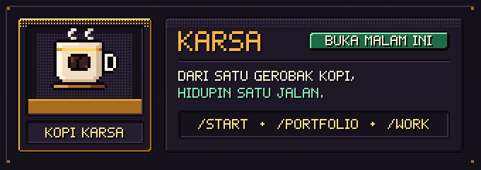
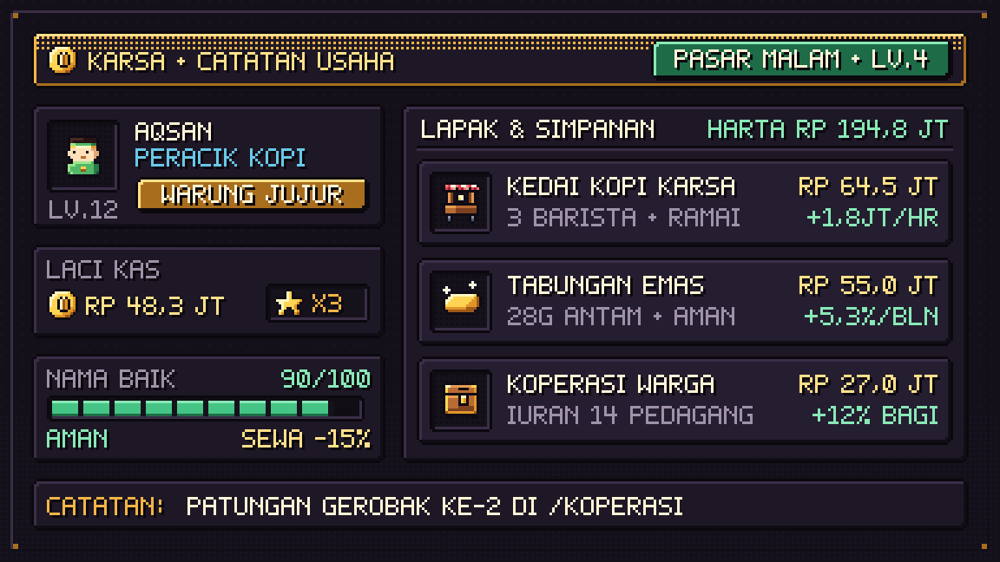
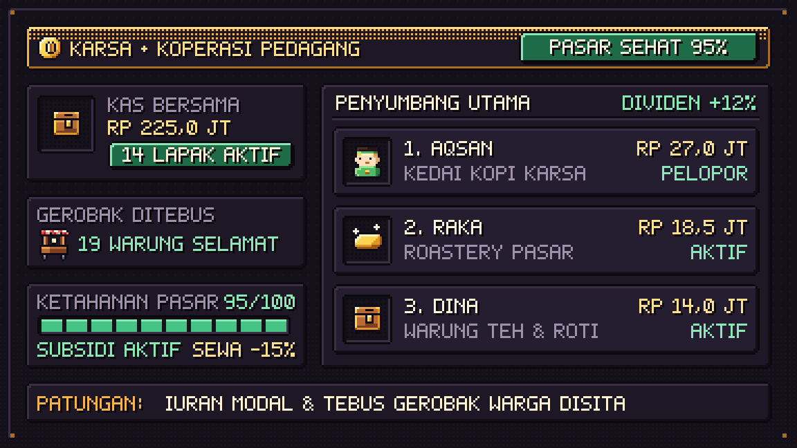
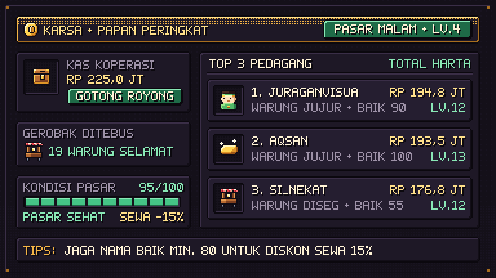
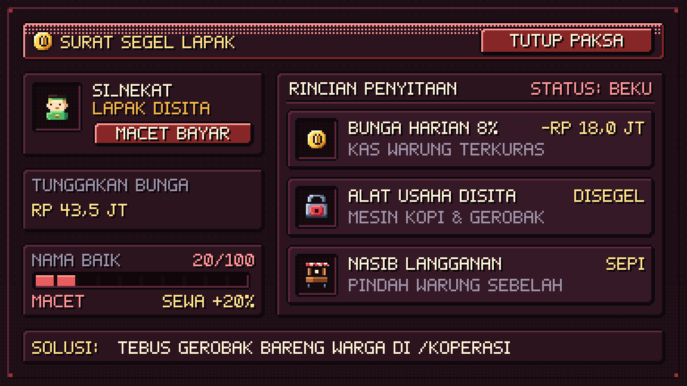
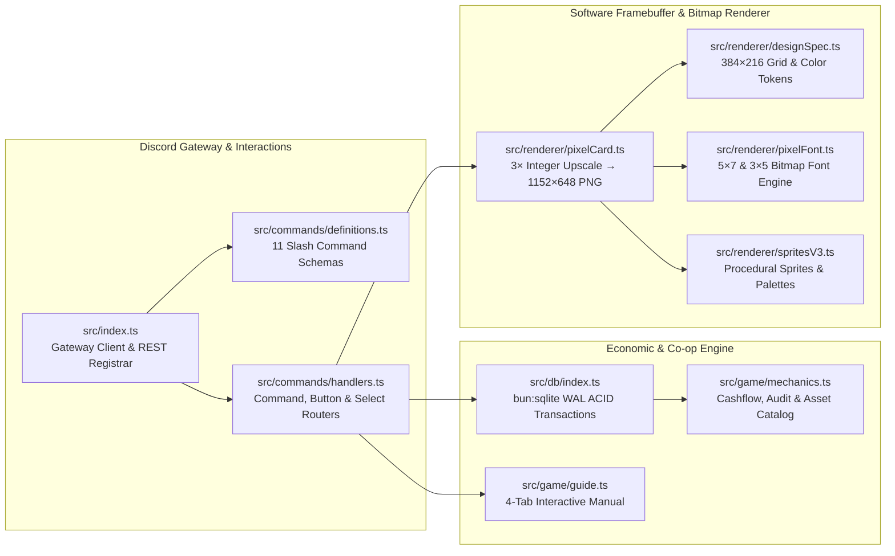

<div align="center">
  

  <h1>KARSA</h1>
  <p><strong>Mesin ekonomi warung kopi &amp; pasar malam untuk komunitas Discord berbasis arus kas riil, kolam likuiditas koperasi, dan perender piksel perangkat lunak di memori.</strong></p>

  <p>
    
    
    
    
    
  </p>
</div>

---

## Ringkasan

**Karsa** adalah mesin ekonomi warung kopi dan pasar malam untuk komunitas Discord yang dibangun di atas mekanika arus kas harian, kolam likuiditas koperasi lintas warga server, dan perender piksel perangkat lunak di memori (*in-memory software pixel renderer*).

Seluruh kartu transaksi, buku kas, kas koperasi, hingga surat penyitaan lapak digambar secara prosedural pada *framebuffer* *native* **384×216** menggunakan *bitmap font* kustom (`5×7` dan `3×5`) lalu diperbesar secara *nearest-neighbor* **3×** menjadi **1152×648** melalui `@napi-rs/canvas` tanpa ketergantungan aset gambar eksternal.

---

## Galeri Visual Kartu

<table>
  <tr>
    <td align="center" width="50%">
      
      <br />
      <sub><strong>Kartu Usaha &amp; Buku Kas Pedagang</strong> — Menampilkan kas tunai, cadangan emas darurat, kekayaan bersih, reputasi pasar, dan rincian unit usaha aktif.</sub>
    </td>
    <td align="center" width="50%">
      
      <br />
      <sub><strong>Kas Koperasi Pasar &amp; Talangan Bersama</strong> — Laporan likuiditas kolektif satu server Discord, indeks kesehatan ekonomi pasar, dan kuota talangan lapak.</sub>
    </td>
  </tr>
  <tr>
    <td align="center" width="50%">
      
      <br />
      <sub><strong>Papan Peringkat Kekayaan Bersih Pasar</strong> — Peringkat 5 pedagang dengan nilai bersih (kas + valuasi unit usaha) tertinggi beserta metrik koperasi server.</sub>
    </td>
    <td align="center" width="50%">
      
      <br />
      <sub><strong>Surat Segel Lapak &amp; Eksekusi Tunggakan</strong> — Bukti penyitaan peralatan usaha dan pemotongan kas otomatis saat gagal bayar pokok beserta bunga berbunga.</sub>
    </td>
  </tr>
</table>

---

## Mekanika Inti & Model Ekonomi

### 1. Siklus Arus Kas Warung Kopi
Setiap pedagang memulai pembukuan dengan modal kas operasional, dana cadangan darurat, dan tiga unit aset produktif (**Kedai Kopi Karsa**, **Tabungan Emas**, dan **Koperasi Warga**). Ekspansi level aset menggunakan kurva biaya majemuk $C_n = C_0 \times 1{,}25^{(n-1)}$ dan meningkatkan setoran harian sebesar $+35\%$ dari *base yield* unit terkait. Saat mencairkan hasil usaha harian, pasar mengenakan potongan retribusi standar sebesar **20%**, atau **5%** (diskon potongan **15%**) bagi pedagang dengan skor reputasi pasar $\ge 80$.

### 2. Pengadaan Bahan Baku & Probabilitas Inspeksi Pasar
Giliran kerja harian (`/work`) menghadapkan pedagang pada keputusan operasional nyata—seperti pengadaan biji kopi Gayo di tengah lonjakan harga pengepul, tawaran penempatan materi promosi pihak ketiga di meja kasir, serta pencatatan pembukuan retribusi bulanan:
- **Operasional Standar**: Menghasilkan laba bersih terukur ($\text{Rp } 1.450.000 - \text{Rp } 1.600.000$), menaikkan reputasi pasar ($+5$ s.d. $+8$), serta memberikan bonus pelanggan tetap sebesar **+15%** apabila reputasi berada pada $\ge 80$.
- **Spekulasi Margin & Oplosan**: Memangkas biaya bahan baku atau memanipulasi pembukuan untuk mengejar margin kotor sesaat ($\text{Rp } 2.600.000 - \text{Rp } 4.500.000$), namun memiliki probabilitas inspeksi/audit pasar sebesar **55%–70%** yang memicu denda langsung ($\text{Rp } 4.200.000 - \text{Rp } 8.500.000$) dan penurunan reputasi ($-15$ s.d. $-25$).

### 3. Brankas Emas Darurat (Kebal Sita)
Kekayaan pedagang dipisahkan antara **Kas Laci** (`balance`), **Valuasi Unit Usaha** (`user_businesses`), dan **Brankas Emas Darurat** (`emergency_fund`). Saat terjadi gagal bayar utang atau penyitaan paksa atas peralatan warung, eksekutor hanya dapat memotong kas laci dan menyegel aset operasional kedai; saldo di dalam Brankas Emas Darurat bersifat likuiditas terproteksi yang kebal dari penyitaan paksa.

### 4. Kolam Likuiditas Koperasi Server & Talangan Utang
Seluruh pedagang dalam satu server Discord berbagi satu entitas `server_coop` yang sama:
- **Iuran Likuiditas (`patungan`)**: Setoran **Rp 5.000.000** per transaksi langsung menambah `pool_balance` server, meningkatkan nilai penyertaan modal koperasi pedagang, menaikkan *daily yield* sebesar **+Rp 450.000/hari**, dan memulihkan indeks kesehatan ekonomi pasar (`eco_health`).
- **Talangan Lapak (`rescue`)**: Anggaran **Rp 10.000.000** dapat digunakan untuk menebus surat segel dan melunasi seluruh pokok tunggakan (`pinjol_debt` kembali ke `0`), memulihkan status lapak menjadi `WARUNG JUJUR`, serta menambah kuota `rescued_count` server.

### 5. Bunga Majemuk Harian & *House Edge*
Fitur `/jalan-pintas` menerapkan perhitungan matematis tanpa filter atas dua instrumen berisiko tinggi:
- **Pinjaman Kilat Ilegal**: Pencairan pokok **Rp 15.000.000** dengan akumulasi bunga majemuk **8% per hari** beserta biaya administrasi paksa (**Rp 28.500.000**), menghasilkan total kewajiban jatuh tempo **Rp 43.500.000**, pemotongan kas laci hingga **Rp 18.000.000**, dan penyegelan mesin kopi kedai.
- **Putaran Meja Malam**: Ekspektasi nilai negatif (*house edge*) yang menguras **65%** saldo kas aktif (minimum **Rp 5.000.000**), menyisakan utang baru **Rp 19.500.000**, menyita gerobak beserta stok bahan baku, dan menurunkan indeks kesehatan koperasi server sebesar **-5 poin**.

---

## Arsitektur Sistem



```text
[Discord Gateway / Interactions]      src/index.ts, src/commands/{definitions,handlers}.ts
              │
              ▼
[Economic & Co-op Engine]             src/db/index.ts (SQLite WAL ACID), src/game/{mechanics,guide}.ts
              │
              ▼
[Software Framebuffer & Renderer]     src/renderer/* (384×216 native framebuffer ──3×──► 1152×648 PNG via @napi-rs/canvas)
```

---

## Referensi 11 Perintah (*Slash Commands*)

| Perintah | Parameter | Cooldown / Biaya | Perilaku & Mekanika (`src/db/index.ts`) |
| :--- | :--- | :--- | :--- |
| `/start` | — | Sekali registrasi | Membuka buku kas pedagang baru (modal tunai awal Rp 10.000.000 + dana darurat Rp 2.000.000 pada skema dasar / paket lapak aktif) beserta unit usaha awal dan merender kartu portofolio. |
| `/help` | — | Tanpa batas | Menampilkan panduan interaktif 4 tab kategori: **Dasar**, **Usaha & Aset**, **Koperasi**, serta **Risiko Pinjaman & Meja Putaran**. |
| `/daily` | — | Cooldown **20 jam** | Mencairkan suntikan modal harian Rp 2.500.000 + bonus *streak* ($\min(\text{streak}, 7) \times \text{Rp } 350.000$) + bonus reputasi Rp 500.000 (jika reputasi $\ge 80$) serta **+2 Reputasi**. |
| `/portfolio` | `warga?: User` | Tanpa batas | Merender kartu PNG **1152×648** berisi kas, cadangan emas, valuasi usaha, reputasi, serta 2 baris tombol navigasi cepat. |
| `/card` | `warga?: User` | Tanpa batas | Alias langsung dari `/portfolio` untuk memeriksa kartu buku kas milik sendiri atau pedagang lain di server. |
| `/work` | — | Per giliran | Menyajikan skenario operasional warung: opsi standar (+15% bonus pendapatan pada reputasi $\ge 80$) atau opsi spekulasi margin (probabilitas inspeksi pasar **55%–70%** dengan denda hingga Rp 8.500.000). |
| `/bisnis` | — | Biaya *upgrade* $C_0 \times 1{,}25^{n-1}$ | Mengelola ekspansi **Kedai Kopi Karsa**, **Tabungan Emas**, dan **Koperasi Warga** (+35% *base yield* tiap kenaikan level) serta klaim setoran harian (diskon potongan sewa 15% pada reputasi $\ge 80$, dari 20% menjadi 5%). |
| `/koperasi` | — | Patungan **Rp 5 Juta** / Tebus **Rp 10 Juta** | Mengelola kolam likuiditas `server_coop`: iuran kas bersama (+Rp 450.000 *yield*/hari, +8 reputasi) atau tebus segel tunggakan warga (`pinjol_debt = 0`, +20 reputasi, +1 *Gem*). |
| `/leaderboard` | — | Tanpa batas | Merender kartu visual peringkat 5 pedagang dengan *Net Worth* (`balance + SUM(value)`) tertinggi di server beserta bar kesehatan koperasi. |
| `/shop` | — | Gratis s.d. **Rp 25 Juta** | Katalog tema visual kartu (*Retro Arcade Gold*, *Default Wood*, *GameBoy Classic Green*, *Cyberpunk Sunda Neon*) dengan fitur *Ephemeral Live Preview* atas nama pengguna sendiri. |
| `/jalan-pintas` | — | Bunga **8%/hari** / Potongan **65% kas** | Eksekusi pinjaman kilat (pokok Rp 15 Juta + beban bunga/denda Rp 28,5 Juta) atau meja putaran malam yang memicu penerbitan **Surat Segel Lapak** dan penyitaan aset usaha. |

---

## Mulai Cepat, Pengujian & CI

### 1. Instalasi Dependensi
Pastikan [Bun](https://bun.sh) (`>= 1.2.0`) telah terpasang di sistem Anda:
```bash
bun install
```

### 2. Mode Demo Lokal (Tanpa Token Discord)
Menjalankan simulasi transaksi database SQLite WAL dan merender seluruh kartu sampel ke direktori `./output/` tanpa memerlukan koneksi ke Discord Gateway:
```bash
bun start --demo
```

### 3. Verifikasi Perender Kartu & Aset Branding
Merender ulang seluruh variasi kartu portofolio, kas koperasi, papan peringkat, dan surat segel lapak ke `./output/`:
```bash
bun run src/test-render.ts
```

Merender ulang identitas visual bot (`bot_avatar_512.png` dan `bot_banner_680x240.png`):
```bash
bun run src/render-branding.ts
```

### 4. Pemeriksaan Tipe Statis & Rangkaian Pengujian
Jalankan pemeriksaan tipe TypeScript (`tsc --noEmit`) dan rangkaian pengujian unit/integrasi (`bun:test`):
```bash
bun run typecheck
bun test
```

### 5. Menjalankan Bot di Server Discord
Salin berkas konfigurasi `.env.example` ke `.env`, isi `DISCORD_TOKEN` dan `DISCORD_CLIENT_ID` (serta `DISCORD_GUILD_ID` opsional untuk registrasi *slash command* instan pada server pengembangan), lalu jalankan:
```bash
cp .env.example .env
bun start
```
