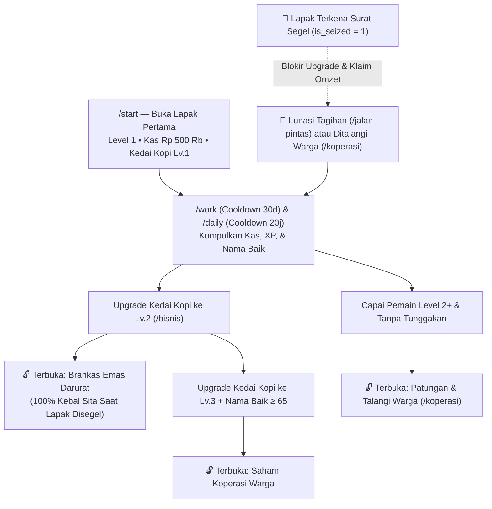

<div align="center">
  

  <h1>☕ KARSA</h1>
  <p><strong>Mesin Ekonomi Warung Kopi &amp; Koperasi Pasar Malam untuk Komunitas Discord</strong><br/><em>Night-Market Coffee Stall &amp; Cooperative Economy Bot for Discord Communities</em></p>

  <p>
    <a href="#-bahasa-indonesia"></a>
    <a href="#-english-documentation"></a>
  </p>

  <p>
    
    
    
    
    
  </p>
</div>

---

## 🖼️ Visual Showcase / Galeri Kartu Visual

<table>
  <tr>
    <td align="center" width="50%">
      
      <br />
      <sub><strong>Kartu Catatan Usaha (<code>/portfolio</code>)</strong><br/>Buku kas pedagang, brankas darurat, skor nama baik, dan rincian unit usaha.</sub>
    </td>
    <td align="center" width="50%">
      
      <br />
      <sub><strong>Kartu Koperasi Pedagang (<code>/koperasi</code>)</strong><br/>Kas bersama satu server, kuota tebus gerobak warga, dan penyumbang utama.</sub>
    </td>
  </tr>
  <tr>
    <td align="center" width="50%">
      
      <br />
      <sub><strong>Papan Peringkat Pasar (<code>/leaderboard</code>)</strong><br/>Top pedagang berdasarkan total kekayaan bersih &amp; reputasi pasar.</sub>
    </td>
    <td align="center" width="50%">
      
      <br />
      <sub><strong>Surat Segel Lapak (<code>/jalan-pintas</code>)</strong><br/>Penyitaan aset usaha saat tunggakan bunga harian melewati batas aman.</sub>
    </td>
  </tr>
</table>

---

# 🇮🇩 Bahasa Indonesia

## 1. Gambaran Umum
**KARSA** adalah bot ekonomi Discord bertema pasar malam dan peracik kopi jalanan yang dirancang dengan sistem progresi berjenjang (*strict progression gates*), buku kas berbasis transaksi **SQLite WAL ACID**, serta mesin perender kartu visual *in-memory* (`384×216` *native grid* yang diperbesar secara *nearest-neighbor* **3×** menjadi `1152×648` PNG dalam ~30ms).

Pemain merintis usaha benar-benar dari bawah (**Level 1**, modal awal **Rp 500.000**, dan **Kedai Kopi Lv.1**), mengatur belanja bahan baku harian, membuka akses ke **Brankas Darurat** dan **Saham Koperasi**, serta bergotong royong bersama warga satu server Discord.

---

## 2. Alur Pemain & Syarat Terbuka (*Progression Gates*)

Agar alur permainan jelas dan terstruktur, **KARSA** menerapkan sistem prasyarat (*"Belum A, Tidak Bisa B"*):



| Fitur / Aksi | Syarat Buka (*Prerequisite Gate*) | Cooldown / Aturan |
| :--- | :--- | :--- |
| **Semua Perintah & Tombol** | Wajib membuka lapak terlebih dahulu lewat `/start` | Sekali pendaftaran (tidak mereset progres lama) |
| **Seduh Kopi (`/work`)** | Lapak terdaftar (`/start`) | **30 detik** antar-giliran seduh |
| **Uang Belanja (`/daily`)** | Lapak terdaftar (`/start`) | **20 jam** (hangus *streak* jika lewat **48 jam**) |
| **Klaim Omzet (`/bisnis`)** | Memiliki unit usaha aktif & lapak **tidak disegel** | **5 menit** antar-pencairan omzet |
| **Buka Brankas Emas (`/bisnis`)** | **Kedai Kopi mencapai Level 2+** & lapak tidak disegel | Dana di dalam brankas **100% kebal sita** |
| **Buka Saham Koperasi (`/bisnis`)** | **Kedai Kopi mencapai Level 3+** & **Nama Baik ≥ 65** | Menghasilkan dividen harian pasif |
| **Patungan & Talangi (`/koperasi`)** | **Pemain mencapai Level 2+** & **tidak punya tunggakan** | Patungan Rp 5 Jt / Talangi rekan Rp 10 Jt |
| **Beli Tema Kartu (`/shop`)** | Bebas tunggakan (`pinjol_debt = 0`) & lapak tidak disegel | Dilengkapi *Live Preview* atas nama sendiri |

---

## 3. Daftar 11 Perintah (*Slash Commands*)

| Perintah | Deskripsi Singkat |
| :--- | :--- |
| `/start` | Membuka lapak pertama di Pasar Malam KARSA (Modal Kas Rp 500.000 & Kedai Kopi Lv.1). |
| `/help` | Membuka buku pedoman interaktif 4 bab (*Buka Lapak*, *Seduh & Bahan*, *Koperasi Pasar*, *Talangan & Segel*). |
| `/portfolio` | Mencetak Kartu Catatan Usaha (`1152×648` PNG) lengkap dengan 2 baris tombol aksi cepat. |
| `/card` | Alias cepat dari `/portfolio` untuk melihat kartu milik sendiri atau pedagang lain. |
| `/daily` | Mengambil uang belanja pasar harian dengan bonus *streak* bertingkat hingga 7+ hari. |
| `/work` | Menjalankan giliran seduh kopi & menghadapi pilihan belanja bahan baku di pasar. |
| `/bisnis` | Menaikkan level Kedai Kopi, membuka Brankas Emas & Saham Koperasi, serta mencairkan omzet. |
| `/koperasi` | Menyetor iuran kas koperasi server atau menebus gerobak warga yang terkena segel. |
| `/leaderboard` | Mencetak kartu visual **Papan Peringkat** 5 pedagang terkaya beserta kesehatan pasar server. |
| `/shop` | Mencoba *live preview* dan mengganti tema visual Kartu Usaha (*Retro Gold*, *GameBoy*, *Glodok Cyber*, *Keraton*). |
| `/jalan-pintas` | Mengakses fasilitas Talangan Kilat (bunga 8%/hari), Meja Putar Belakang, atau **Melunasi Tagihan Segel**. |

---

## 4. Menjalankan dengan Docker (Rekomendasi untuk Laptop & Migrasi VPS)

Proyek ini sudah dilengkapi `Dockerfile`, `docker-compose.yml`, dan skrip portabel `./docker-sync.sh` sehingga seluruh *runtime* Bun, *font* piksel, dan *library* kanvas langsung berjalan di dalam kontainer tanpa perlu menginstal dependensi di *host*.

### A. Menyalakan Bot di Docker (24/7 Auto-Restart)
```bash
cp .env.example .env
# Isi DISCORD_TOKEN dan DISCORD_CLIENT_ID di dalam .env
./docker-sync.sh up
```

### B. Mereset Seluruh Statistik Pemain ke Nol (Fresh Wipe)
```bash
./docker-sync.sh reset
# atau melalui CLI Bun secara langsung:
bun run src/index.ts --reset-db
```

### C. Memindahkan Bot + Database dari Laptop ke VPS (1 Perintah)
```bash
# 1. Di laptop: buat bundel portabel (.tar.gz berisi kode + .env + database SQLite)
./docker-sync.sh backup

# 2. Kirim ke VPS dan jalankan:
scp /home/nojin/Documents/00_Obsidian_HQ/06_Infra_&_Backup/karsa-bot-docker-latest.tar.gz user@ip-vps:~/
ssh user@ip-vps "tar -xzf karsa-bot-docker-latest.tar.gz && cd kota-mandiri-bot && ./docker-sync.sh up"
```

---

# 🌐 English Documentation

## 1. Overview
**KARSA** is a Discord coffee-stall and night-market economy bot built with **Bun**, **TypeScript (`strict`)**, **discord.js v14**, **SQLite WAL (ACID transactions)**, and a **zero-AI-slop procedural pixel-art UI engine** (`@napi-rs/canvas`).

Every player card, server cooperative dashboard, leaderboard, and seizure notice is rendered in-memory on a strict **384×216 native pixel grid** using a custom 5×7 bitmap font engine and integer-upscaled **3×** to **1152×648 PNG** in ~30ms.

---

## 2. Progression Flow & Prerequisite Gates ("If Not A, Cannot Do B")

Players begin from scratch (**Level 1**, **Rp 500,000** starter cash, **Lv.1 Coffee Stall**, and locked advanced assets) and unlock features progressively:

1. **Account Registration Gate (`/start`)**: Unregistered users attempting any command or button interaction receive an ephemeral onboarding prompt with a one-click **`🪪 Buka Lapak Pertama`** button. Running `/start` again never overwrites an existing player's progress.
2. **Work & Leveling (`/work` — 30s Cooldown)**: Completing coffee-brewing shifts awards cash, reputation (*Nama Baik*), and XP (`Level = 1 + floor(XP / 100)`).
3. **Asset Unlock Tree (`/bisnis` — 5m Claim Cooldown)**:
   - **Kedai Kopi (Coffee Stall)**: Unlocked at **Level 1**.
   - **Brankas Emas (Emergency Vault)**: Locked (`Lv.0`) until **Kedai Kopi reaches Level 2**. Funds stored here are **100% immune to asset seizure**.
   - **Saham Koperasi (Co-op Shares)**: Locked (`Lv.0`) until **Kedai Kopi reaches Level 3** and **Reputation ≥ 65**.
4. **Server Cooperative Gate (`/koperasi`)**: Contributing to the server liquidity pool or bailing out a sealed stall requires **Player Level 2+** and **zero active high-interest debt**.
5. **Seizure Lockdown & Recovery (`is_seized = 1`)**: If high-interest loan debt (`8%/day` compound) exceeds the seizure threshold, the player's stall is sealed—blocking business upgrades, passive income claims, and skin purchases until they repay the debt (`💸 Bayar / Lunasi Tagihan`) or are bailed out by fellow server members in `/koperasi`.

---

## 3. Architecture & Directory Structure

```text
kota-mandiri-bot/
├── assets/fonts/                 # Embedded pixel fonts (PressStart2P, Silkscreen)
├── src/
│   ├── index.ts                  # Gateway entrypoint, rotating presence, --demo & --reset-db CLI
│   ├── commands/
│   │   ├── definitions.ts        # 11 Discord Slash Command schemas
│   │   └── handlers.ts           # Interaction routers, registration gates & button flows
│   ├── db/
│   │   ├── schema.ts             # Drizzle/SQLite table definitions
│   │   └── index.ts              # ACID transactions, progression gates & cooldown engine
│   ├── game/
│   │   ├── mechanics.ts          # Work dilemmas, business catalog & yield calculators
│   │   └── guide.ts              # 4-tab interactive player handbook (/help)
│   └── renderer/
│       ├── designSpec.ts         # Mathematical grid constants, bevels & 4 color themes
│       ├── pixelFont.ts          # Custom 5×7 bitmap pixel font renderer
│       ├── spritesV3.ts          # Hand-crafted 16×16 & 24×24 pixel sprites
│       ├── renderAvatarV3.ts     # 32×32 → 512×512 circle-crop-safe bot avatar generator
│       ├── renderBannerV3.ts     # 340×120 → 680×240 bot profile banner generator
│       ├── renderPortfolioV3.ts  # Portfolio, Co-op & Seizure card renderers
│       └── renderLeaderboardV3.ts# Top 3 server leaderboard card renderer
├── tests/
│   └── karsa.test.ts             # Unit & integration test suite (ACID, gates, cooldowns, PNG bytes)
├── Dockerfile                    # Production Bun + Skia container definition
├── docker-compose.yml            # Persistent volume & auto-restart orchestration
└── docker-sync.sh                # One-command up / reset / VPS backup & restore utility
```

---

## 4. Development, Testing & Docker Deployment

```bash
# Install dependencies
bun install

# Run static typecheck & unit/integration test suite
bun run typecheck
bun test

# Regenerate all visual cards & branding assets into ./output/
bun run src/test-render.ts
bun run src/render-branding.ts

# Wipe all player stats to zero
bun run src/index.ts --reset-db

# Build & run inside Docker (recommended for production / VPS)
./docker-sync.sh up
```
